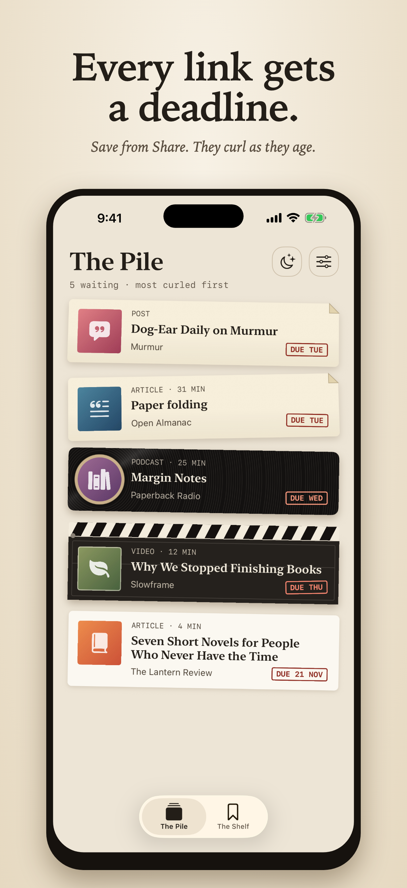
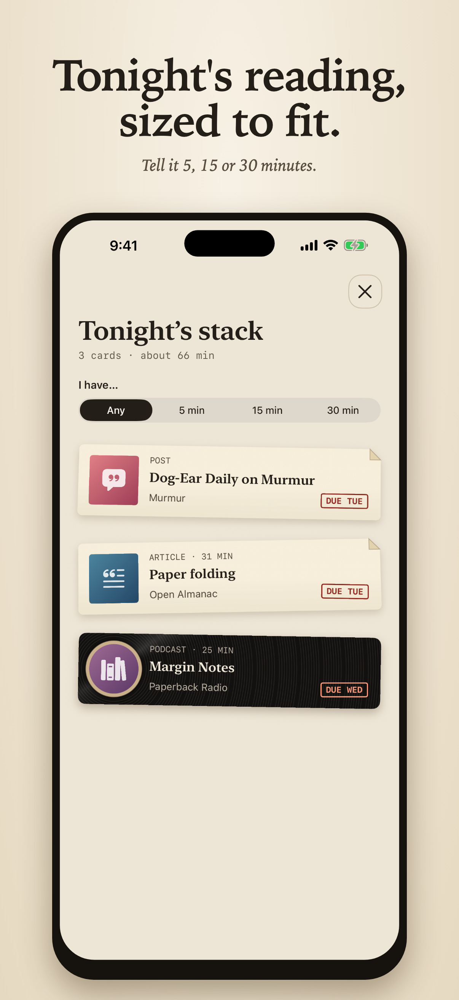
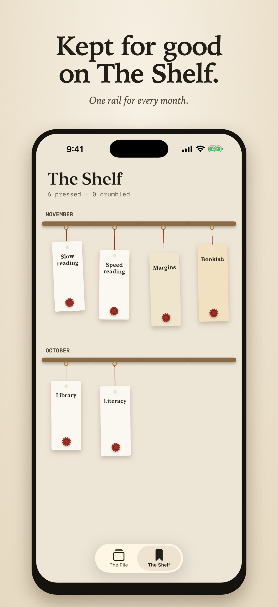
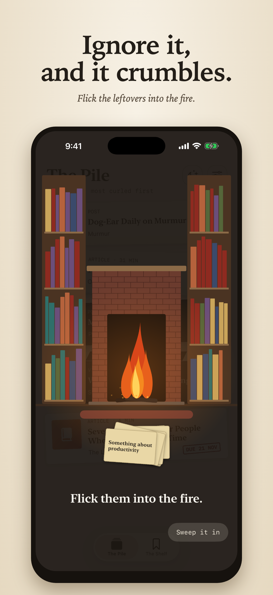

# Pressed

A read-later iOS app where every saved link gets a deadline.

[Website](https://mavene.github.io/pressed-landing/) · [Features](#features) · [More details](#more-details)

<table>
<tr>
<td width="25%"></td>
<td width="25%"></td>
<td width="25%"></td>
<td width="25%"></td>
</tr>
<tr>
<td align="center"><b>The Pile</b></td>
<td align="center"><b>The Stack</b></td>
<td align="center"><b>The Shelf</b></td>
<td align="center"><b>The Fireplace</b></td>
</tr>
</table>

## Features

- **Save it in a second.** Save a link from the Share sheet in Safari or any app with a share button. No account needed.
- **Links that age.** The Pile orders cards by due date and stamps them with a due label. Each link lasts 3, 7 or 14 days, your choice.
- **Press it flat.** After reading, add a short note and hold the button to seal the link, with haptic feedback.
- **The Shelf.** Pressed links hang on one rail per month. Reopen one to see its title and your note.
- **Tonight's Stack.** Choose 5, 15 or 30 minutes. Pressed picks about three cards by due date, with some variety.
- **Ignore it long enough and it crumbles.** Expired cards tear, snap or shatter, then you flick the pieces into a waste bin or a fireplace. "Sweep it in" does the throwing for you.
- **Focus mode (coming in 1.1).** Chosen distracting apps lock until you press one link from Tonight's Stack. It uses Screen Time permission and can be turned off in Settings.

## More details

- **Privacy:** no account, server, analytics or third-party SDKs. Data stays on the device.
- **Widget:** Home Screen (small, medium) and Lock Screen. Opening an expired link from the widget gives it one last day, once.
- **Evening reminder:** optional, about links that are about to expire. Never sent when the pile is empty.
- **Deadline:** a card lasts until 23:59:59 on its last day.
- **In-app reader:** links open in Safari's in-app reader.
- **Requires** iOS 18 or later.
